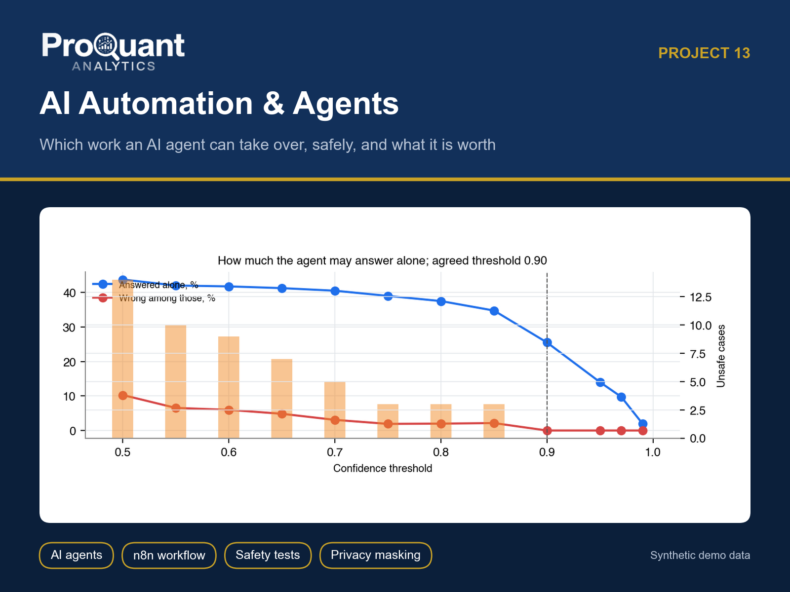
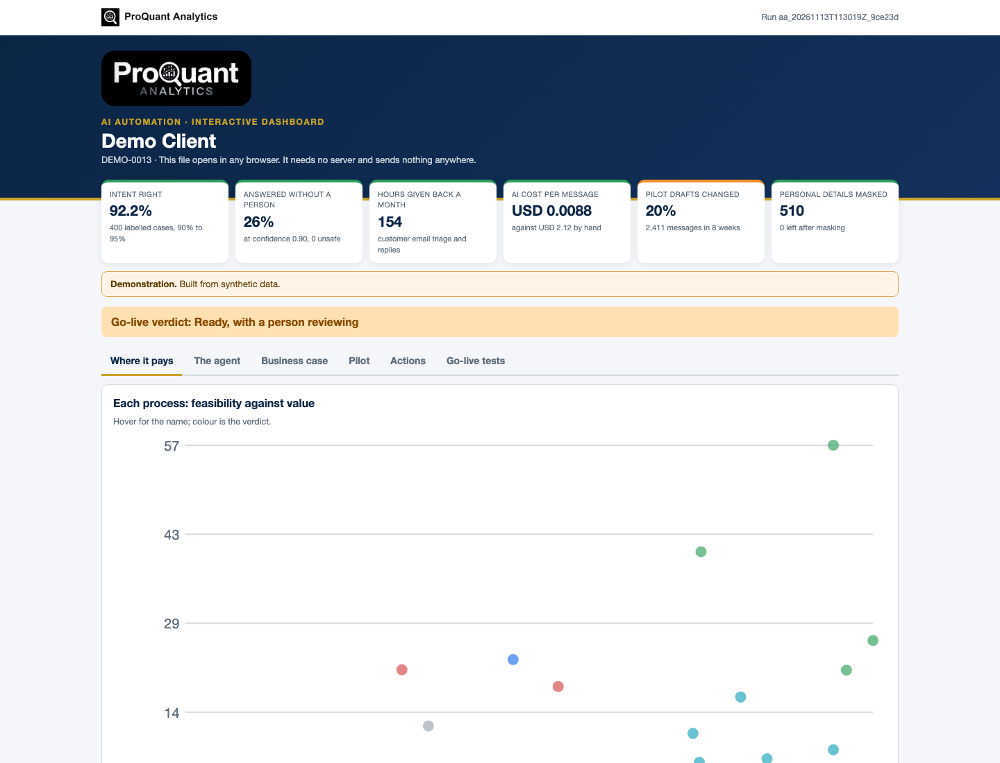
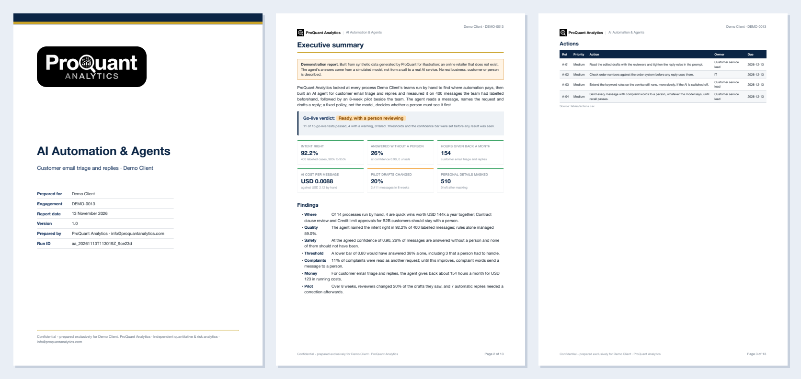
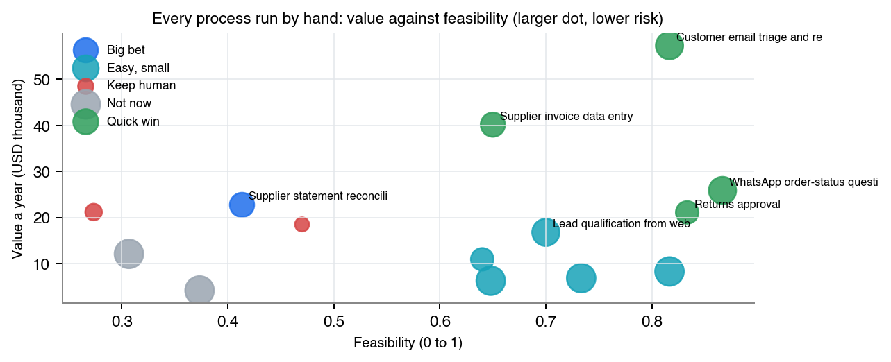
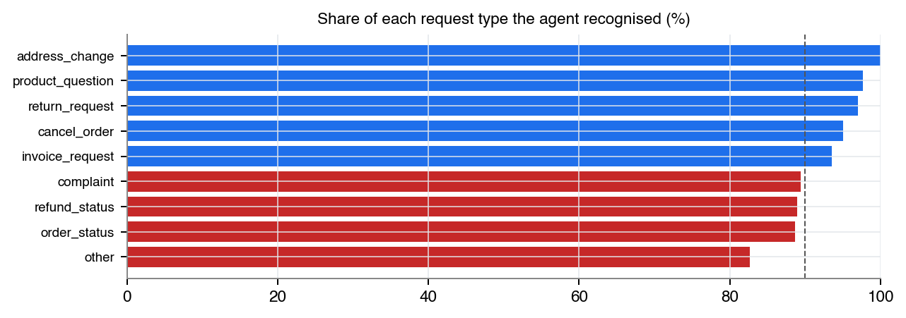
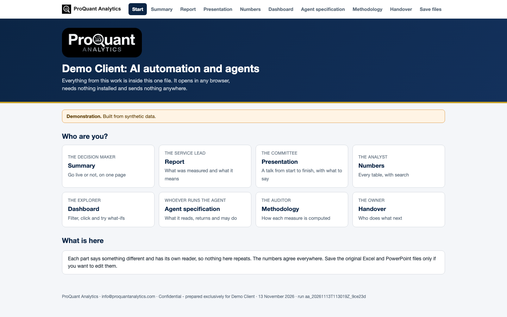

# AI Automation & Agents

**Which manual work an AI agent can take over safely, measured on your own cases, and installed on your own platform.**

  

> **Showcase repository.** It shows the method and the actual files a client receives, built on **synthetic demo data** (a fictional *Demo Client*). The numbers below are illustrative, not client results. The production code is proprietary and is not published here.

## Contents

- [Business problem](#business-problem)
- [Approach](#approach)
- [Results (demo)](#results-demo)
- [Deliverables](#deliverables)
- [Gallery](#gallery)
- [Tech stack](#tech-stack)
- [How to view it](#how-to-view-it)
- [How an engagement works](#how-an-engagement-works)

## Business problem

AI agents are easy to demo and hard to trust. Nobody knows how often the agent is wrong, which mistakes matter, whether personal data reaches the model, what happens when the AI service is down, or whether the hours saved are real.

**Typical clients:** Customer-service, finance and operations teams in any business, from a shop answering WhatsApp to a company with a help desk and an AI policy.

## Approach

- Every manual process scored for value, feasibility and risk, with build cost and payback
- Personal details (e-mail, phone, card, IBAN) masked before any model sees a message, with proof nothing was missed
- An agent on Claude with structured output; a fixed policy, not the model, decides what is sent without a person
- Measured on cases the client's team labelled beforehand: accuracy, unsafe replies, errors among automatic replies, cost and speed
- A pilot beside the team: reviewer edits, corrections, hours given back against the plan, drift
- An automation pack for n8n, Make, Power Automate or Zapier, with no-AI fallback rules and a golden set to re-test every change

## Results (demo)

**Overall opinion on the demo data:** Go-live verdict: Ready, with a person reviewing

| Measure | Value | Context |
|---|---:|---|
| Intent right | **92.2%** | 400 labelled cases, 90% to 95% |
| Answered without a person | **26%** | at confidence 0.90, 0 unsafe |
| Hours given back a month | **154** | customer email triage and replies |
| AI cost per message | **USD 0.0088** | against USD 2.12 by hand |
| Pilot drafts changed | **20%** | 2,411 messages in 8 weeks |
| Personal details masked | **510** | 0 left after masking |

<em>The interactive dashboard (one HTML file: Where it pays, The agent, Business case, Pilot, Actions, Go-live tests). <a href="https://abduwars.github.io/proquant-13-ai-automation-agents/sample-delivery/10_DemoClient_AIAutomation_Dashboard_v1.0_20261113.html">Open it live</a>.</em>

## Deliverables

Everything opens from **one file**, *Start here* (no. 1), in any browser: pick your role, read each document, watch the presentation, search the tables and use the dashboard. Each document has one reader and one job, and the numbers agree across all of them. PowerPoint and Excel files open in the browser through Microsoft's free online viewer; *download* gives the original file.

| # | File | Format | What it is |
|---|---|---|---|
| 1 | [Start here](https://abduwars.github.io/proquant-13-ai-automation-agents/sample-delivery/00_START_HERE_DemoClient.html) | HTML (opens in any browser) | **One file that holds it all**: every document, the presentation, the tables and the dashboard |
| 2 | [Report](sample-delivery/01_DemoClient_AIAutomation_Report_v1.0_20261113.pdf) | PDF | *The service lead*: What was measured and what it means (~13 pages) |
| 3 | [Summary](sample-delivery/02_DemoClient_AIAutomation_Summary_v1.0_20261113.pdf) | PDF | *The decision maker*: Go live or not, on one page |
| 4 | [Presentation](https://view.officeapps.live.com/op/view.aspx?src=https%3A%2F%2Fabduwars.github.io%2Fproquant-13-ai-automation-agents%2Fsample-delivery%2F03_DemoClient_AIAutomation_Presentation_v1.0_20261113.pptx) | PowerPoint · [download](https://raw.githubusercontent.com/AbduWars/proquant-13-ai-automation-agents/main/sample-delivery/03_DemoClient_AIAutomation_Presentation_v1.0_20261113.pptx) | *The management team*: A full talk with editable charts and speaker notes |
| 5 | [Results Workbook](https://view.officeapps.live.com/op/view.aspx?src=https%3A%2F%2Fabduwars.github.io%2Fproquant-13-ai-automation-agents%2Fsample-delivery%2F04_DemoClient_AIAutomation_ResultsWorkbook_v1.0_20261113.xlsx) | Excel · [download](https://raw.githubusercontent.com/AbduWars/proquant-13-ai-automation-agents/main/sample-delivery/04_DemoClient_AIAutomation_ResultsWorkbook_v1.0_20261113.xlsx) | *The analyst*: Every case and table, a live Control panel |
| 6 | [Methodology](sample-delivery/05_DemoClient_AIAutomation_Methodology_v1.0_20261113.pdf) | PDF | *The auditor*: How each measure is computed |
| 7 | [Handover Note](sample-delivery/06_DemoClient_AIAutomation_HandoverNote_v1.0_20261113.pdf) | PDF | *The owner*: Who does what next |
| 8 | [Opportunity Map](https://view.officeapps.live.com/op/view.aspx?src=https%3A%2F%2Fabduwars.github.io%2Fproquant-13-ai-automation-agents%2Fsample-delivery%2F07_DemoClient_AIAutomation_OpportunityMap_v1.0_20261113.xlsx) | Excel · [download](https://raw.githubusercontent.com/AbduWars/proquant-13-ai-automation-agents/main/sample-delivery/07_DemoClient_AIAutomation_OpportunityMap_v1.0_20261113.xlsx) | *Each process owner*: Every process with a status and a next step; the dashboard reads it back |
| 9 | [Agent Specification](sample-delivery/08_DemoClient_AIAutomation_AgentSpecification_v1.0_20261113.pdf) | PDF | *Whoever runs the agent*: What it reads, returns and may do |
| 10 | [Dashboard](https://abduwars.github.io/proquant-13-ai-automation-agents/sample-delivery/10_DemoClient_AIAutomation_Dashboard_v1.0_20261113.html) | HTML (opens in any browser) | *Whoever explores*: Opportunities, the agent, the business case with your own numbers, the pilot, actions |

**Delivered to clients only, not in this showcase:** the automation pack (n8n workflow, prompt, policy, fallback rules, golden set).

Also delivered: data-quality reports and long-format CSV / Parquet exports for Power BI or Looker Studio.

<em>The first pages of the PDF report.</em>

## Gallery

<table><tr>
<td width="50%"></td>
<td width="50%"></td>
</tr></table>

<em>The start page: one file, one click, nothing to install.</em>

## Tech stack

Python · pandas · NumPy · matplotlib · Jinja2 + WeasyPrint (PDF) · openpyxl (Excel) · python-pptx (PowerPoint) · pydantic · pytest · Claude API (Anthropic SDK) · n8n · Make · Power Automate · Zapier · structured outputs

Every run is reproducible and audited: data fingerprints, configuration and code version are recorded, data-quality checks run before any calculation, and an automated test suite checks every deliverable (including opening the decks and workbooks in Microsoft Office).

## How to view it

1. **In the browser (nothing to install):** open the [live start page](https://abduwars.github.io/proquant-13-ai-automation-agents/sample-delivery/00_START_HERE_DemoClient.html) or the [dashboard](https://abduwars.github.io/proquant-13-ai-automation-agents/sample-delivery/10_DemoClient_AIAutomation_Dashboard_v1.0_20261113.html).
2. **Download:** click any PDF, Excel or PowerPoint file in the table above, or clone the repository: `git clone https://github.com/AbduWars/proquant-13-ai-automation-agents.git`.
3. **On your own data:** this is delivered as a fixed-scope engagement. Write to [info@proquantanalytics.com](mailto:info@proquantanalytics.com).

## How an engagement works

| Step | What happens |
|---|---|
| 1. Discovery call | Your question, your data and the decision the work must support |
| 2. Scope and NDA | Fixed scope, timeline and thresholds agreed **before** any result is seen |
| 3. Data request | A precise list of files or read-only access; personal data pseudonymised |
| 4. Build and interim update | First results, open questions and data issues, early |
| 5. Delivery | The full package above, on your data, with a walk-through |
| 6. Handover | Methodology, runbook where relevant, and optional monthly refresh |

---

<b>ProQuant Analytics</b> · Quant & risk analytics, business analytics, data engineering and AI automation Rotterdam, NL · remote-first <a href="https://www.proquant-analytics.com">www.proquant-analytics.com</a> · <a href="mailto:info@proquantanalytics.com">info@proquantanalytics.com</a> · <a href="https://github.com/AbduWars">All 13 projects</a>

© 2026 ProQuant Analytics. Sample outputs on synthetic data, shown for demonstration. All rights reserved.

